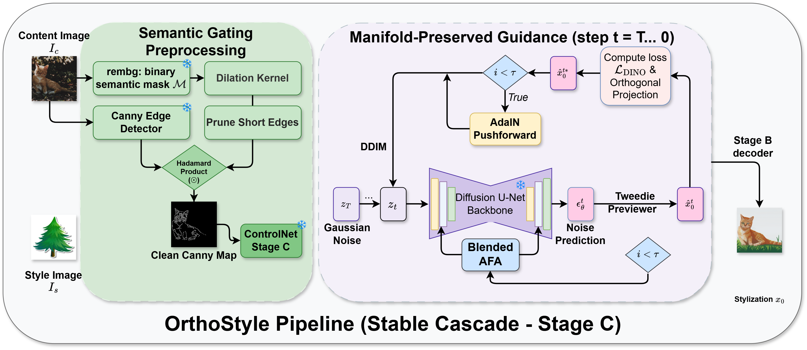
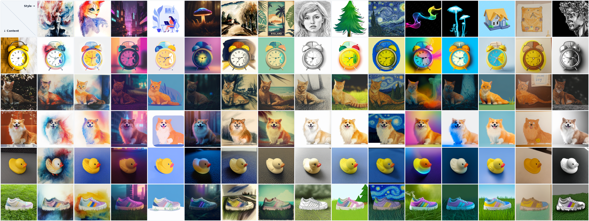

<h1 align="center">OrthoStyle: Manifold-Preserving Training-Free Style Transfer via Score-Orthogonal Guidance</h1>

<p align="center">
  
  
  <a href="https://github.com/xdnhatnguyen/OrthoStyle/blob/gh-pages/SOICT_2026_OthorStyle.pdf"></a>
  <a href="https://xdnhatnguyen.github.io/OrthoStyle/"></a>
  <a href="LICENSE"></a>
</p>

---

## 📢 News

- [x] **2026.10.18**: OrthoStyle has been accepted to SOICT 2026 (Oral Presentation)!
- [x] **2026.11.02**: [Code](https://github.com/xdnhatnguyen/OrthoStyle) and [project page](https://xdnhatnguyen.github.io/OrthoStyle/) are publicly available!

---

## 🧭 Overview

**OrthoStyle** is a training-free framework for zero-shot, reference-guided image style transfer built on latent diffusion models (Stable Cascade). It addresses the fundamental trade-off between style fidelity, content structure preservation, and content leakage without requiring model fine-tuning, inversions, or LoRA training.

The core contributions include:

- 📐 **Semantic Gating**: Automatically isolates the primary foreground subject using `rembg` segmentation to filter out background edge clutter, enforcing sharp object contours and geometry preservation via ControlNet Canny.
- 🧭 **Score-Orthogonal DINO Guidance**: Decomposes the DINO style gradient and projects it strictly orthogonal to the diffusion score direction $\boldsymbol{\epsilon}$, eliminating gradient conflicts on the score manifold to transfer authentic artistic style without geometric distortion.
- ⏱️ **Early Step Controller**: Controls the style injection trajectory across early reverse diffusion timesteps (via AdaIN latent pushforward and sigmoid attention scheduling), effectively preventing content leakage from reference images.

<p align="center">
  
</p>
<p align="center"><em>Figure 1: Architectural pipeline of OrthoStyle. During reverse diffusion, Score-Orthogonal Guidance and AdaIN latent pushforward guide the drift field while semantic-gated ControlNet features preserve spatial geometry.</em></p>

---

## 🎨 Qualitative Results

OrthoStyle achieves faithful artistic transfer across diverse semantic categories and contrasting artistic styles under null-prompt inference ($p=\text{""}$), preserving fine structural details without unwanted semantic leakage from the style reference.

<p align="center">
  
</p>
<p align="center"><em>Figure 2: Qualitative stylization matrix across 15 diverse content objects and 15 artistic genres under null-prompt inference. Preserves subject geometry faithfully while capturing authentic textures without semantic leakage.</em></p>

---

## ⚙️ Installation

```bash
# 1. Clone repository and set up conda environment
git clone https://github.com/xdnhatnguyen/OrthoStyle.git
cd OrthoStyle
conda create -n ortho python=3.10 -y
conda activate ortho
pip install -r requirements.txt

# 2. Download Stable Cascade pretrained weights
mkdir -p third_party/StableCascade/models
cd third_party/StableCascade/models
bash download_models.sh essential big-big bfloat16
cd ../../..

# 3. Download ControlNet Canny weights
wget -O third_party/StableCascade/models/canny.safetensors \
    https://huggingface.co/stabilityai/stable-cascade/resolve/main/controlnet/canny.safetensors

# 4. Download pretrained CSD weights (place at third_party/CSD/checkpoint.pth)
mkdir -p third_party/CSD
# Download checkpoint.pth from: https://drive.google.com/file/d/1FX0xs8p-C7Ob-h5Y4cUhTeOepHzXv_46/view
# and place at: third_party/CSD/checkpoint.pth
```

---

## 🚀 Usage

### 📂 Prepare Input Images

Place content and style images under the `data/` directory:

```text
data/
├── content/
│   ├── berry_bowl.png
│   ├── dog_sitting.png
│   └── rubber_duck.png
└── style/
    ├── antimonocromatismo.png
    ├── 3d_isometric.png
    └── crayon_drawing.png
```

---

### ▶️ Run OrthoStyle

By default, running `main.py` executes the full pipeline with all core mechanisms enabled (ControlNet Canny, `rembg` semantic gating, Score-Orthogonal Guidance, and AdaIN pushforward):

```bash
# Run with default sample images
python main.py

# Run with custom content and style images
python main.py --content data/content/dog_sitting.png --style data/style/3d_isometric.png
```

#### Generated Outputs (Saved in `output/`):
- **Standalone Stylized Image** ($1024 \times 1024$):
  `output/ortho_<content>_<style>.png`
- **3-Panel Comparison Grid** ($3072 \times 1024$):
  `output/grid_<content>_<style>.png` (`[Content | Style | Output]`)

---

### 📊 Benchmark Batch Evaluation

To run batch evaluation across benchmark image pairs:

```bash
python main.py --batch --config_path data/benchmark_config.json --start_idx 1 --end_idx 225
```

---

## 📂 Repository Structure

```text
OrthoStyle/
├── main.py              # Main execution entrypoint (single-pair inference & batch runner)
├── guidance.py          # Sampler with Score-Orthogonal Guidance & AdaIN pushforward
├── stage_c_ortho.py     # Modified Stage C architecture with ControlNet and AFA cross-attention
├── utils.py             # Feature storage, conditioning, and helper utilities
├── requirements.txt     # Python dependencies for the ortho environment
├── third_party/         # Pretrained model backbones and utilities
│   ├── CSD/             # Content-Style Disentanglement modules
│   └── StableCascade/   # Stable Cascade core architecture and models
├── data/
│   ├── content/         # Sample content reference images
│   └── style/           # Sample style reference images
├── assets/
│   ├── pipeline.png     # Architectural method pipeline diagram
│   ├── our.png          # High-resolution benchmark comparison preview
│   └── qualitative_matrix_teaser.png  # Qualitative stylization matrix teaser
└── README.md            # Project documentation
```

---

## 📚 Citation

If you find OrthoStyle useful for your research, please consider citing:

```bibtex
@inproceedings{orthostyle2026,
  title     = {OrthoStyle: Manifold-Preserving Training-Free Style Transfer via Score-Orthogonal Guidance},
  booktitle = {The 15th International Symposium on Information and Communication Technology (SOICT)},
  note      = {Oral Presentation},
  year      = {2026}
}
```

---

## 🙏 Acknowledgements

Our implementation builds upon [RB-Modulation](https://github.com/google/RB-Modulation). We thank the authors for their open-source contribution.

---

## 📄 License

This project is licensed under the Apache 2.0 License.
